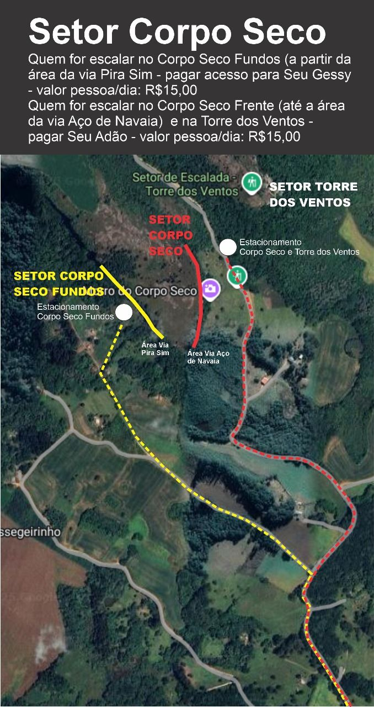

## Setor Corpo Seco e Torre dos Ventos

**LOCALIZAÇÃO:** <https://maps.app.goo.gl/YWBSMX6yNnLQkiBB7>

SETOR CORPO SECO – ATUALIZAÇÃO DE ACESSO PARA OS FUNDOS (14/07/2025)  
Informamos que houve uma atualização no acesso aos Fundos do Setor Corpo Seco.  
Quem for no Corpo Seco Frente (até a área da via Aço de Navaia) ou na Torre dos Ventos continua pagando normal, como é feito atualmente (R$15,00 pessoa/dia), para a Rosane Ruvinski, filha do seu Adão – whatsapp +55 42 9923-7037 – PIX CPF: 09424279981  
Quem for escalar no Setor Corpo Seco Fundos (a partir da área da via Pira Sim), deve estacionar o carro no novo local de estacionamento, no sítio do Seu Gê (<https://maps.app.goo.gl/axcLqVTkPSXKnN9C8>), valor de R$15,00 pessoa/dia – Gessy Sidnei Bueno – whastapp +55 42 9856-4974 – PIX fd28936f-8f1b-4032-8c4f-467e55586d5c  
Por favor, pedimos para que respeitem as áreas delimitadas, pagando sempre os proprietários das áreas onde estiverem escalando, para que possamos manter os acessos aos setores sem problemas.

---

## Setor Amigos, Araucárias e Pedras Brancas

**LOCALIZAÇÃO:** <https://goo.gl/maps/czLzrF6J7hFsmXiT7>

ACESSO: o mapa te leva até o final de uma estrada, neste ponto entra numa porteira à esquerda, em direção à casa que está em frente às paredes.

**ACESSO ÀS PAREDES:** A trilha sai atrás da casa e vai em direção às paredes para o Setor Amigos. Para o Setor Araucárias, a trilha sai à direita, atrás do pomar.

Verificar valores com a proprietária

**CONTATO PROPRIETÁRIA:** Cinara +55 42 9958-6318 Pix: 933.980.509-72 (Cinara de Souza Gomes) MANDAR MENSAGEM INFORMANDO O NOME DAS PESSOAS QUE ESTÃO INDO E OS DIAS QUE IRÃO FICAR NO LOCAL.

**TERMO DE RESPONSABILIDADE:** a ser preenchido apenas na primeira vez que acessar o setor: <https://forms.gle/trWx33RExn8RnCyG9>

**OBRIGATÓRIO USO DE CAPACETE** – as vias são todas novas e agarras podem quebrar. A proprietária pediu para que todos usem capacete para evitar acidentes. Pedimos esta colaboração, pois em caso de acidente, perderemos o setor.

**ATENÇÃO:** para que tenhamos uma boa convivência, mantenha o local limpo e leve seu lixo embora!
