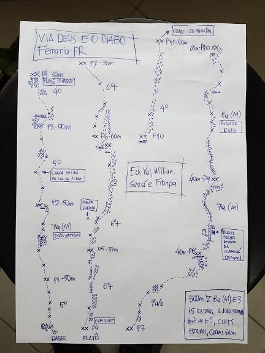
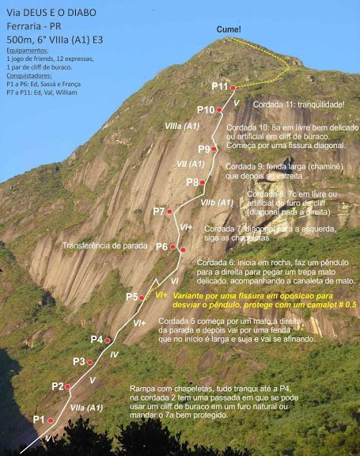

Relato: Maurilio Hadas

Era metade de agosto e estava pensando no feriado de 7 de setembro, em busca de uma nova aventura. Mandei uma mensagem para o Leandro Cechinel, no whatsapp, perguntando qual roubada iríamos encarar no feriadão, prontamente o mesmo me respondeu: **Deus e o Diabo**? Eu como sempre, aceitei na mesma hora . Um dia de treino comentamos com nosso amigo Rodrigo C. Alcine, mais conhecido com Sonic, sobre nossa ideia e o mesmo topou na mesma hora, começamos a planejar a escalada, pois a via estava bem no nosso limite, então precisávamos pensar em todos os detalhes possíveis. Optamos por fazer a  escalada com pernoite, primeiro porque tínhamos o feriado inteiro e segundo porque queríamos estar inteiros para escalar a via.

*Chegada na base da via com os últimos raios de sol – Foto: Leandro Cechinel*

A aventura começou no sábado dia 05, nos encontramos no CT alienígena que é como chamamos a casa do Sonic, onde treinamos semanalmente. Arrumamos as mochilas pela manhã, aproximadamente 15 kg para cada (equipamentos + comida), almoçamos uma marmita e saímos em direção a Serra do Mar.

A trilha de acesso a base do Ferraria é pela Chácara Rio das Pedras, a aproximação é longa e dividida em duas partes bem definidas, primeiramente uma estrada usada na época da construção das torres de alta tensão que conectam o litoral, depois a trilha segue por um rio seco até a base da via, a trilha está bem sinalizada. Começamos a trilha às 14:00 horas e chegamos na base da via às 18:23, ainda com um pouco de luz, contemplamos a imensidão da parede até escurecer.

<iframe src="https://www.youtube-nocookie.com/embed/1eezdzTC2jg" title="Vídeo" loading="lazy" allowfullscreen></iframe>

Para andar o mais leve possível, optamos por só levar redes e para agilizar a montagem do acampamento cada um ficou responsável por uma atividade (organizar o equipamento de escalada, buscar a água, preparar a janta). Nessa trip o cozinheiro foi o Leandro, que preparou um macarrão com proteína de soja fenomenal! A noite estava estrelada, com um mar de nuvens abaixo da gente.

Combinamos de iniciar a via às 5:30, pra poder pegar o nascer do sol já na parede. Acordamos às 4:50, como já tínhamos organizado tudo no dia anterior conseguimos cumprir nossa meta de início. Existe duas versões de croquis, imprimimos um atrás do outro e passamos papel contact para facilitar o uso na parede.

**Croquis da Via**

 

Sonic se prontificou a guiar a primeira enfiada, o visual estava animal, era possível ver a lua e um início de nascer do sol ao mesmo tempo. Na sequência eu guiei a segunda e terceira enfiada. Sonic fez a quarta enfiada, nesse momento o sol já tinha rompido a barreira do mar de nuvens e o calor já começa a dar sinais que vinha com força!

*Sonic na primeira enfiada da Deus e o Diabo – Foto: Maurílio Vagetti*

Era aproximadamente 8:00 e já estávamos reunidos na quarta parada, como Leandro queria fazer a sexta enfiada, marcada por uma fissura que é um dos seus estilos preferidos, e Sonic já tinha guiado a quarta fiquei responsável pela quinta enfiada, que começa pela direita e depois encontra uma chaminé que vira fenda. Antes de iniciar a enfiada, não quis levar o camalot #5 por causa do peso, quando chego na fenda adivinha qual a peça que era perfeita? A peça ajudaria, porém não é essencial.

Leandro entrou guiando a sexta enfiada, no croqui existe duas opções (pêndulo ou fissura), como queríamos ganhar tempo fomos pela fissura, a linha é bem óbvia, começa bem linear para cima e depois entra a direita em uma fissura em oposição, protegendo com um #.5 e depois toca pra cima por um trepa mato delicado.

E lá vamos nós para a sétima enfiada! Eu fiquei com essa, começa bem óbvia para cima e depois uma transversal para esquerda. Essa hora o mar de nuvens tinha dado uma sumida e era possível ver as montanhas em volta, uma vista não muito comum, devido a face que se encontra a parede. Confesso que só conseguir apreciar a vista depois de chegar na P7, um tempo longe das parede cobrou o preço no psicológico.

##### Um descanso no meio da via

Nessa hora, perto do meio dia, o sol estava castigando. Leandro guiou a oitava enfiada que é uma transversal para a direita, a P8 está em cima de um platô de mato, onde é possível se abrigar do sol, aproveitamos para fazer um lanche e dar uma descansada.

Sonic estava cansado e com um pouco de dores, provenientes de outra escalada no final de semana anterior, e optou por ficar por ali. Ele incentivou a gente a continuar e disse que não se importava em esperar a gente no platô, então tocamos pra cima.

Essa enfiada começa em uma uma canaleta de mato ao lado de uma chaminé limpa, na sequência uma fissura e quase na parada é preciso dominar um platô de mato para à direita, chegando na P9.

Nesse momento o corpo já estava quebrado, a última enfiada tinha exigido bastante fisicamente, descansamos por bastante tempo, curtimos o visual… o mar de nuvens tinha voltado e nessa hora o sol já estava virando para a outra face da montanha, o que nos ajudou bastante com uma sombra refrescante.

##### Os últimos metros de escalada

Para a décima enfiada, por sinal a mais bonita e difícil da via, Leandro assumiu a ponta da corda, nada melhor que o relato dele dessa enfiada:

“Depois de um merecido e rápido descanso na parada, entramos na décima enfiada, começa numa fissura bonita para a esquerda, toda em móvel com peças grandes como o camalot #4 e vai afinando onde se pode proteger com um #.3 e até mesmo um C3 #0 no final, a virada para a direita na placa com chapas é bem óbvia, uma virada delicada e divertida, após isso começa a parte mais difícil da via, onde se pode fazer um 8a em livre ou A1 em furos de cliff, já fui preparado para o artificial.

Os primeiros lances foram tranquilos, a minha preocupação era de não encontrar os furos, que para a minha surpresa estavam ótimos e próximos, após progredir alguns bons metros e proteger em algumas chapas, não encontrava mais furos, acabei escolhendo um furo mais alto do que conseguia ver bem, era um furo natural, que por fim não aguentou e explodiu, queda, alguns metros abaixo e mais alguns ralados pra coleção, mas nada de grave, depois encontrei a sequência de furos e segui até o último lance em artificial.

Após dominar um pequeno platô de mato, a linha segue pela direita, com duas chapas pretas bem visíveis, porém existe uma chapa velha para a esquerda na direção de uma canaleta de mato que é fácil passar despercebida e ajuda bastante a quebrar a exposição dos próximos lances, e finalmente chegamos na P10”, contou Leandro.

*Cechinel guiando a 10 enfiada – Foto: Maurílio Vagetti Hadas*

A última enfiada é bem tranquila e assim atingimos a P11, a última da via às 17:36 horas do dia 06/09/2020, que felicidade por ter chegado até o final. Deixamos os equipamentos na parada e fomos até o cume, chegamos no exato momento do pôr do sol, serra linda e com mar de nuvens, assinamos o livro e comemos um sanduba.

*Última parada, missão cumprida – Foto: Maurílio Vagetti Hadas*

##### Rapeis noturnos

Iniciamos os rapeis já no escuro, encontramos o Sonic no caminho e concluímos todos os rapeis com segurança às 23:27 horas. Uma dica é fazer o rapel da P8 diretamente para a P6, para evitar as transversais.

Como ainda tínhamos um dia disponível no calendário, esquentamos a comida que tinha sobrado da janta de sábado e capotamos! Acordamos sem despertador, tomamos um café da manhã e iniciamos nossa pernada de volta, a caminhada de retorno foi um pouco mais rápida, porém exaustiva. Chegamos ao carro exatamente as 14:00 horas do dia 07/09/2020, 48 horas depois que partimos.

Obrigado pela parceria desse time incrível! A sintonia foi sensacional, trabalhamos em equipe e nos divertimos um monte.

Escaladores: Leandro Cechinel, Maurílio Vagetti Hadas e Rodrigo C. Alcine (Sonic);

Agradecimento aos conquistadores, e todos que mandaram energia positiva pra essa empreitada.
