
<iframe src="https://www.youtube-nocookie.com/embed/O_JQryd-V5E" title="Vídeo" loading="lazy" allowfullscreen></iframe>

Sempre gostei de atividades de longa duração, trilhas longas e etc, depois que comecei a escalar, as travessias mistas (caminhada e escalada) me chamaram muita atenção, pra isso só faltava bolar um link desafiador, férias e uma parceria boa pra roubada, aí que entra o Murilo Benvenutti, parceiro de longa data que começou a escalar na mesma época que eu no Clube Paranaense de Montanhismo.

Recentemente soubemos da travessia “Rock’n Roll” feita pelo Ed Padilha e Valdesir Machado (relato no fim), inspirados por esse feito, surgiu a ideia de fazer uma nova travessia linkando também as vias recém abertas na montanha Caratuva, na Agulha Rudolf Stamm, por Márcio Merkl e Maria Inez.

No dia 21 de Julho de 2022 chegamos na Fazenda Rio das Pedras, nas primeiras horas do dia (2h12), começamos a caminhada ali sentido Ferraria, chegando na base da via Aqui se vive (6º VIIIb A1 E2 D4 510m) às 6h02, como ainda estava escuro e bem frio, decidimos fazer um café sem muita pressa e começar a escalar com a luz do sol, exatamente às 7h12 Murilo começou a guiar a primeira enfiada, escolhemos a estratégia de guiar por blocos, cada um guiar metade da via, Murilo ficou com a primeira parte e eu com a segunda.

O começo fluiu muito bem, motivados e cheios de energia, a única dificuldade mesmo era carregar a mochila pesada jumareando com tudo, quem guiava sempre ia leve. Como nenhum de nós conhecia a via, a aventura aumentou um pouco, o que fez com que a gente gastasse um pouco mais de tempo e energia lendo o croqui e navegando, até que chegamos por fim na parada de troca de função, 10h08 na p5, assumi a ponta da corda e o Murilo o assumiu o jumar e peso da mochila grande.

Justo nessa parada as coisas ficaram mais sérias, tanto pro guia quanto pro participante, nessa outra metade da via a parede dá um boa empinada e tudo fica mais difícil, graduação mais dura, alguns lances delicados de artificial em furos de cliff e por aí vai, no geral fomos fazendo em livre tudo até sétimo grau, mas se o lance complicava muito já ia pro artificial para ganhar tempo, afinal tínhamos muito o que escalar ainda nos próximos dias.

Com o sol já castigando um pouco nesse horário, pois a parede fica totalmente exposta ao sol nesse período do dia, chegamos a última parada às 15h17 e essa foi a primeira vez que repetimos essa via, dali pro cume é uma caminhada rápida e inclinada de alguns minutos, Murilo foi tocando pro cume enquanto eu organizava a tralha toda para ir depois.

Como já estávamos com pouca água e chegamos relativamente cedo no cume, decidimos descer no mesmo dia a Crista Leste e acampar no Disco Porto onde haveria água em abundância, então não demoramos muito e já iniciamos a descida (16h20), o objetivo era passar o trecho de cordas que em teoria seria o mais exposto e perigoso ainda de dia.

A vista estava incrível, mar de nuvens, fim de tarde, e na região que considero ter a melhor visão para o Ibitirati, onde se vê todo o paredão desde a base até o cume e toda sua imponência, só de olhar a motivação já foi subindo pra cabeça e superando o cansaço físico, vendo a próxima via que escalaríamos no dia seguinte, a Mar de Caratuvas.

Passamos o trecho de cordas ainda de dia, que era o objetivo, a luz foi diminuindo aos poucos até anoitecer, a Crista Leste estava totalmente fechada, muito ruim de caminhar, com muitos bambus e as mochilas enroscando em tudo, a descida parecia infinita, muito cansativa mentalmente principalmente.

Depois de abrir muito bambu no peito, já sem água, finalmente chegamos ao fim da crista (18h55) que conecta com a Picada de São Cristóvão e pouco depois o tão esperado Disco Porto (19h44), onde armamos acampamento, fizemos um rango e finalizamos o primeiro dia com 17 horas e meia de atividade.

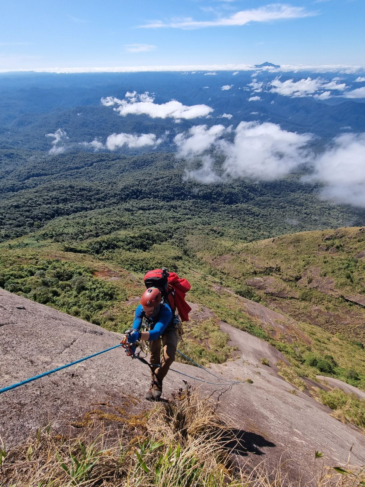 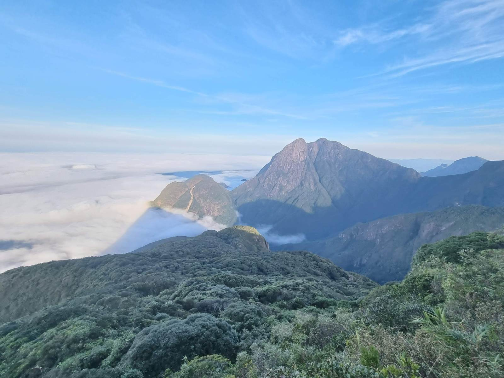 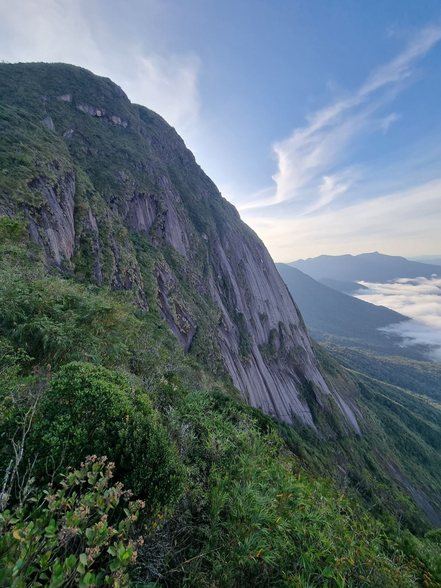 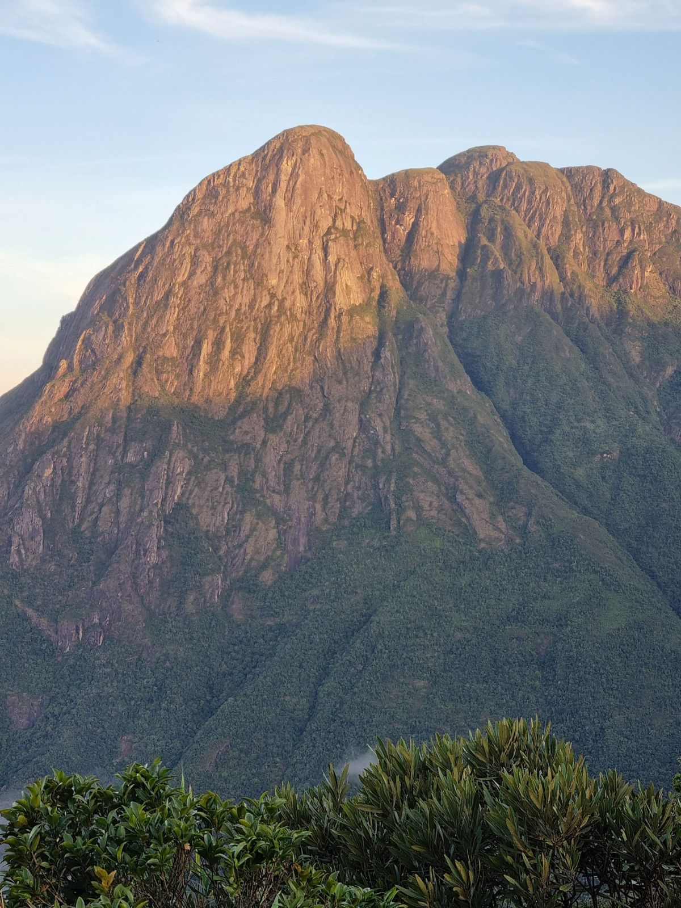 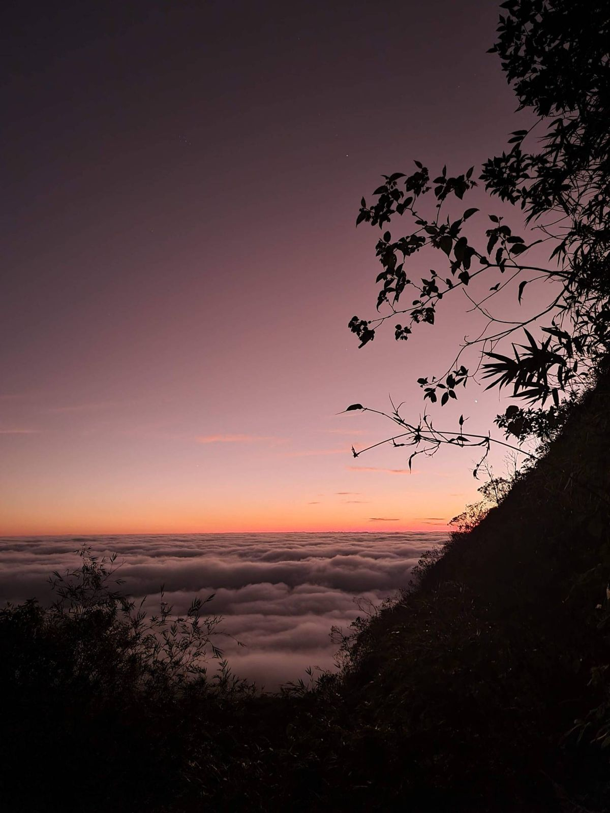 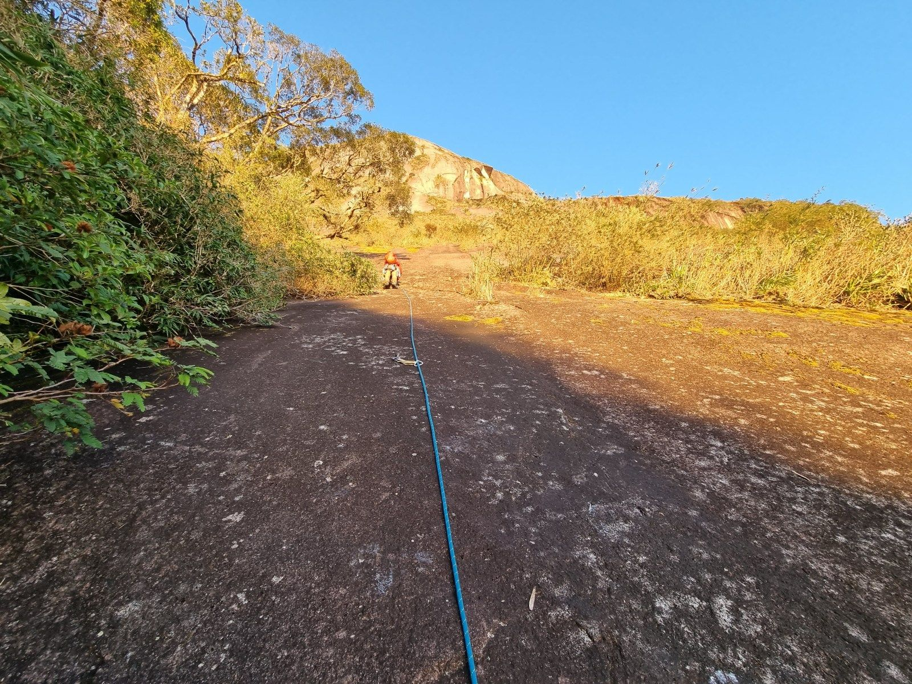 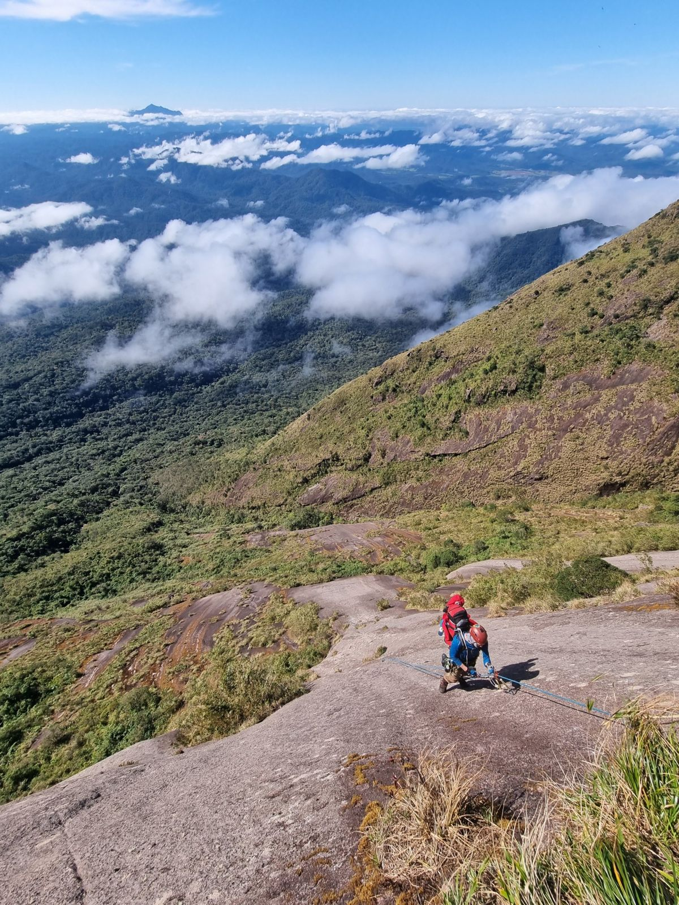 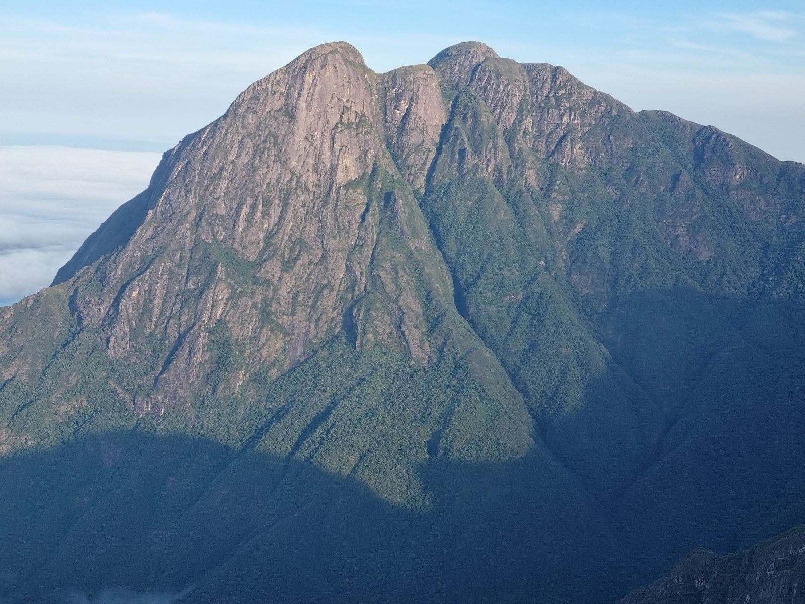

Acordamos às 5h da manhã, fizemos um bom café, aproveitamos ao máximo o rio ao nosso lado, hidratando muito e começamos a trilha sentido base da via Mar de Caratuvas às 7h deixando o rio abundante para trás, passamos pelas cordas fixas (8h30) que inclusive estavam bem feias, algumas somente na alma e já com desgaste.

Equipados e prontos, começamos a Mar de Caratuvas (5° VI E4 D4/D5 621m) às 9h50 com sol já batendo no lombo prometendo muito calor, sinal de fim de temporada, na mesma estratégia de blocos comecei guiando a primeira metade da via, enquanto eu ia fixando a corda ([short-fix](https://www.climbing.com/skills/short-fixing/)), o que agilizou bastante a escalada, Murilo vinha jumareando logo atrás com a mochila pesada e brigando com as caratuvas.

Chegamos no platô Jean Claude e base da próxima enfiada já era 12h34, o calor estava demais, com a pouca água que tínhamos decidimos aproveitar a pouca sombra do platô e retomar a via mais tarde, nem que isso custasse terminar a via de noite, o que não seria ruim com o calor que estava fazendo. Então ficamos por ali mesmo descansando e retomamos a escalada 13h36, que por sorte surgiram algumas nuvens que hora ou outra davam uma trégua no calor.

O combinado era eu guiar até a P7, porém chegando na parada anterior a essa, o Murilo já tinha xingado as caratuvas de tudo que era possível e estava bem cansado, olhei no croqui pra ver como seria a próxima enfiada e só vi “mato”, “muito mato”, “caratuvas”, não ia dar boa kkkk, ali mesmo trocamos as funções e ele assumiu a ponta da corda para guiar todo o resto da via, e eu a mochila e briga com caratuvas.

Nos primeiros 10m de jumar já entendi a revolta do Murilo, com a corda tensionada e por cima das caratuvas era horrível de jumarear, fazendo muito esforço para tirar do caminho e conseguir progredir, mesmo com dois estribos e tudo certinho gastava uma energia absurda para conseguir ganhar altitude, desenroscar as caratuvas da corda, da mochila, cadeirinha, e também não pendular nas diagonais da via. Duas enfiadas depois Murilo já tinha retomado o sorriso no rosto e quem estava xingando era eu kkkk.

Depois de muita batalha, terminamos a via às 20h39, Murilo estava passeando a essa altura, revigorado, já eu estava exausto, me arrastando com a mochila pesada, praticamente sem água, desidratados, seguimos até o verdadeiro cume do Ibitirati.

Armamos acampamento, fizemos algo para comer, porém só tinha nos restado 500ml de água, isso pra passar a noite toda e trilha do dia seguinte, nesse ponto o cansaço já tinha passado um pouco, alguém tinha nos falado anteriormente que poderia ter água entre o União e Pico Paraná, duvidamos, mas na situação que estávamos fomos lá pra ter certeza, dividimos as últimas gotas de água ao chegar no cume do União, e como suspeitamos, nada de água por ali.

Chegamos tão desidratados só nessa pequena caminhada, boca seca, colando, que não tinha como imaginar voltar até a barraca e conseguir dormir, ali resolvemos continuar andando e ir até o A2, que seria o próximo ponto de água, somente com as garrafas vazias e a esperança de ter água, pelo menos a caminhada fluía bem, chegando lá encontramos apenas uma poça de água parada e com bastante sujeira, mas foi o suficiente, nos primeiros goles deu pra sentir a alma voltar pro corpo, bebemos o máximo que conseguimos ali, abastecemos as garrafas e voltamos pro acampamento, depois de ter hidratado, mesmo sendo subida, a volta foi ainda mais rápida, e por fim chegamos de volta ao cume do Ibitirati somente às 2h da manhã, finalizando o segundo dia com 21h de atividade, muita sede, escalada e caminhada.

Pra ajudar, meu isolante inflável acabou furando em algum momento e acordei batendo queixo de frio na madrugada, como eu estava sem saco de dormir, usei a manta metálica de emergência e tive que apelar usando a corda, costuras e tudo que tinha como isolante térmico, inclusive colocando os pés dentro da mochila, mesmo assim não estava dando conta do frio que fazia no cume do Ibitirati, foi aí que comecei a esquentar as águas que tínhamos para me aquecer, e isso garantia algumas horas de sono, deu até saudades do sol que nos torrou durante o dia kkkk.

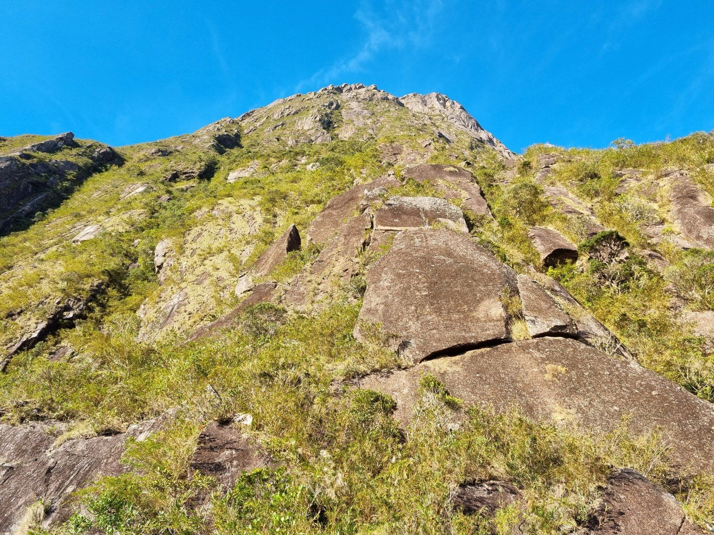 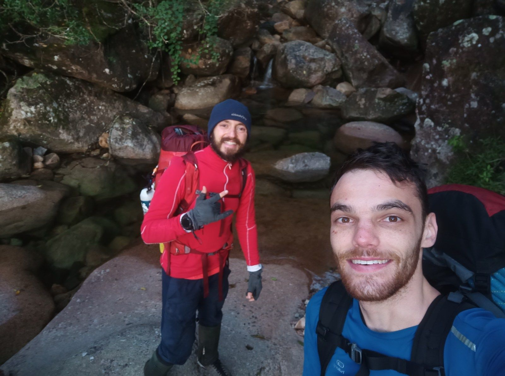 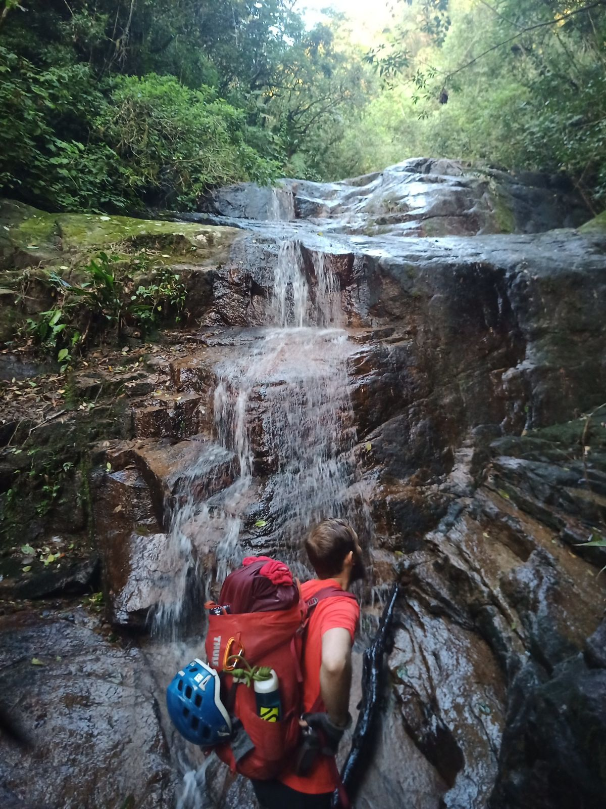 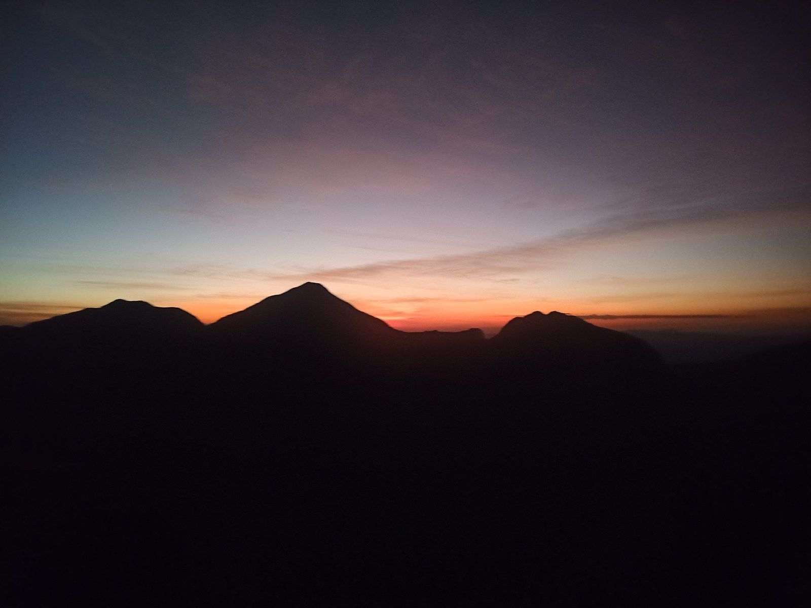 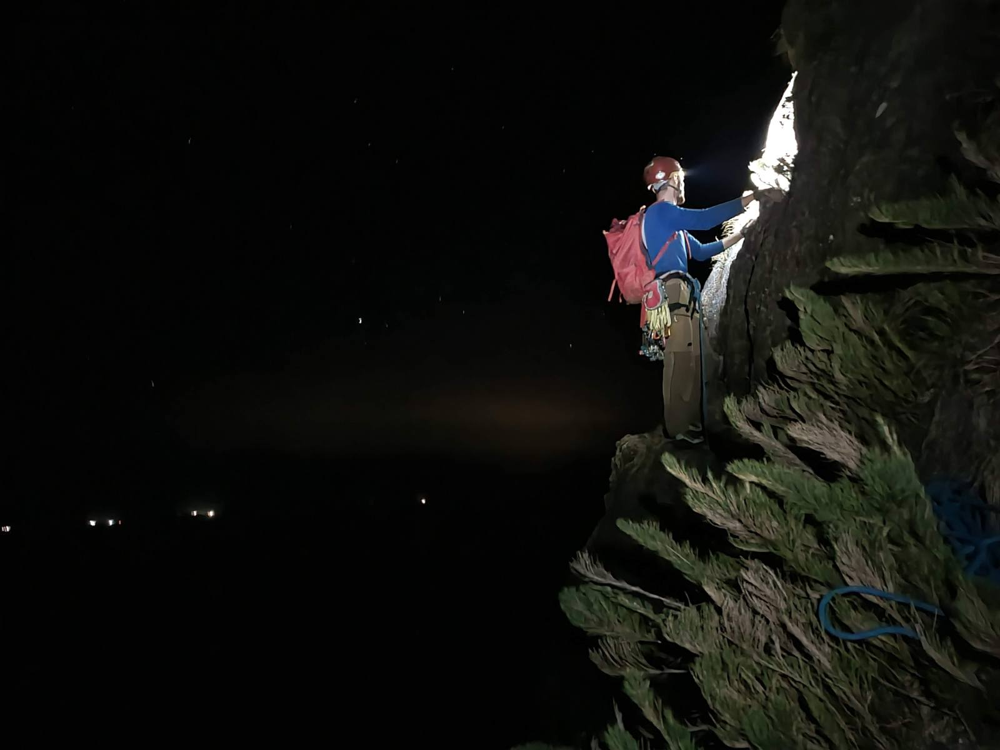 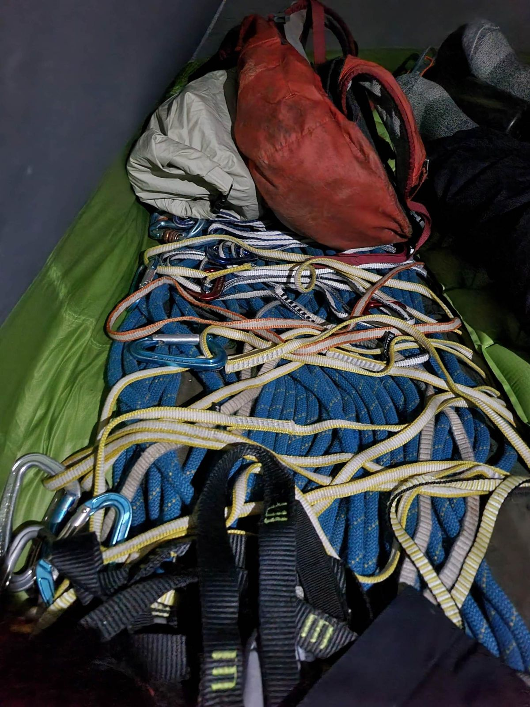

No dia seguinte, visto o empenho do anterior, resolvemos pegar mais leve, acordamos mais tarde, perto das 9h, tomamos um café sem pressa, organizamos toda a tralha e saímos do Ibitirati somente perto de meio-dia, passamos rapidamente pelo União e Pico Paraná, que estava lotado de gente como normalmente é num final de semana.

Chegamos no A2 do Pico Paraná, onde fomos em direção do Morro Camelos para abastecer de água, Murilo acabou ficando no meio do caminho para poupar energia e eu fui com tudo que tínhamos para abastecer de água, com poucas garrafas, neste momento o que nos salvou foi um saco estanque que enchi de água, abastecidos e pesados partimos sentido Caratuva, onde chegamos no cume 16h55, fizemos uma boa comida e descansamos para o dia seguinte, ali discutimos os planos, o objetivo era pegar leve nesse dia, descansar e terminar toda a travessia no dia seguinte, custe o que custasse.

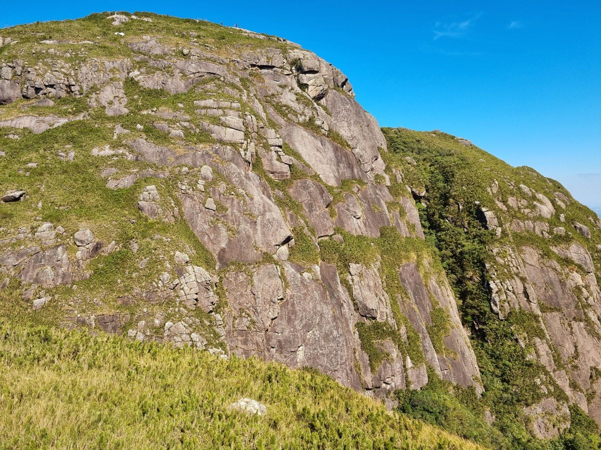 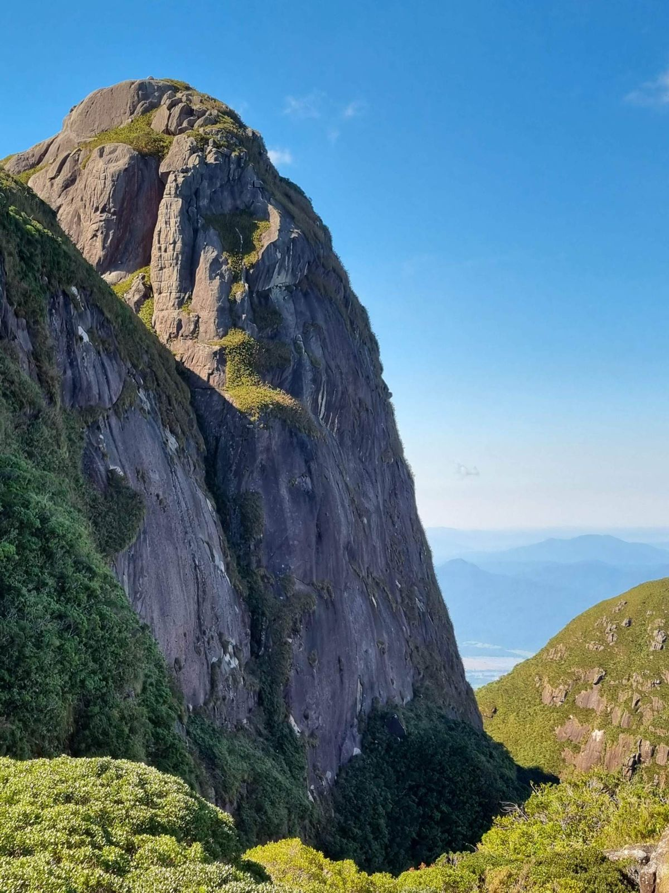 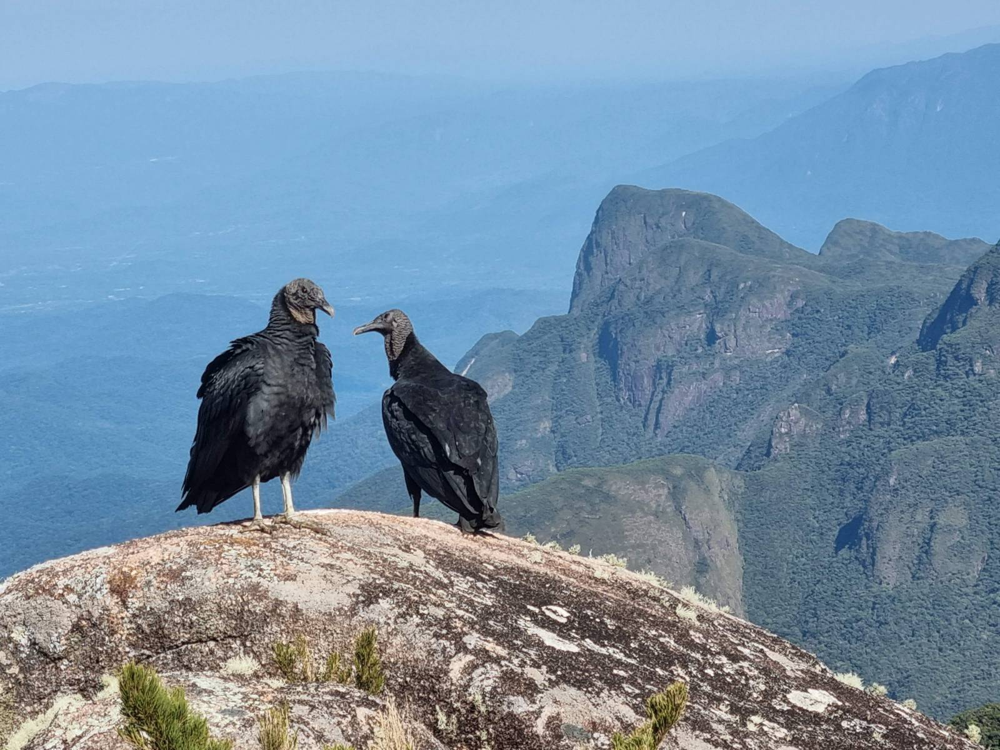 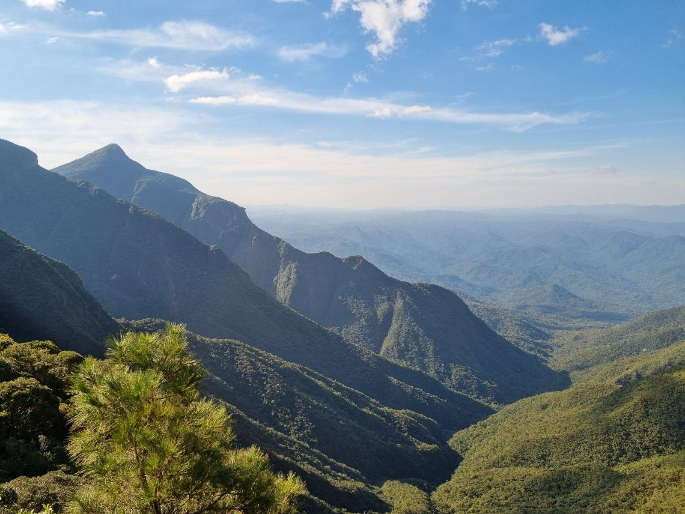 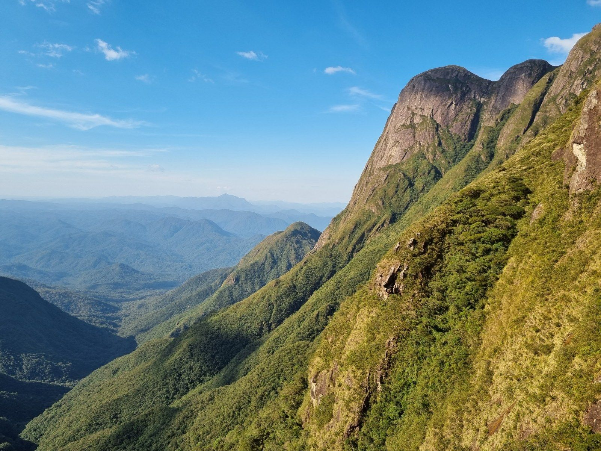 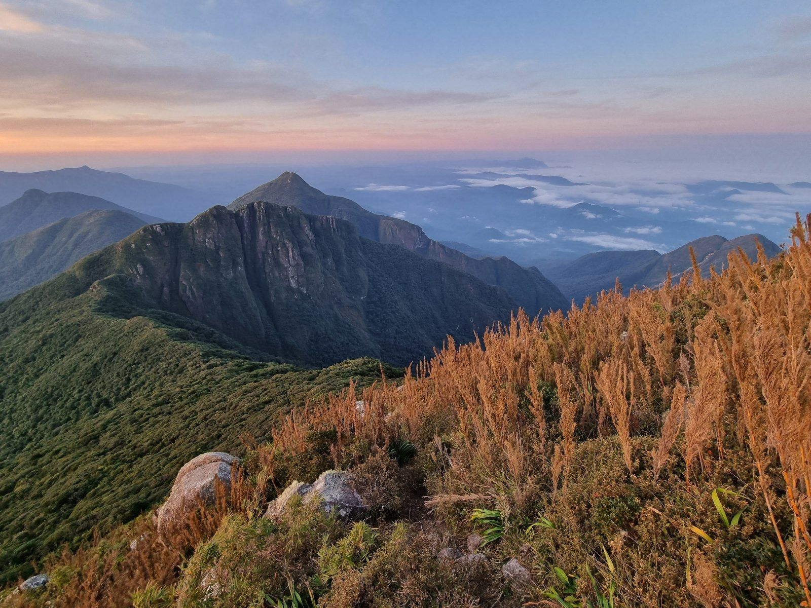 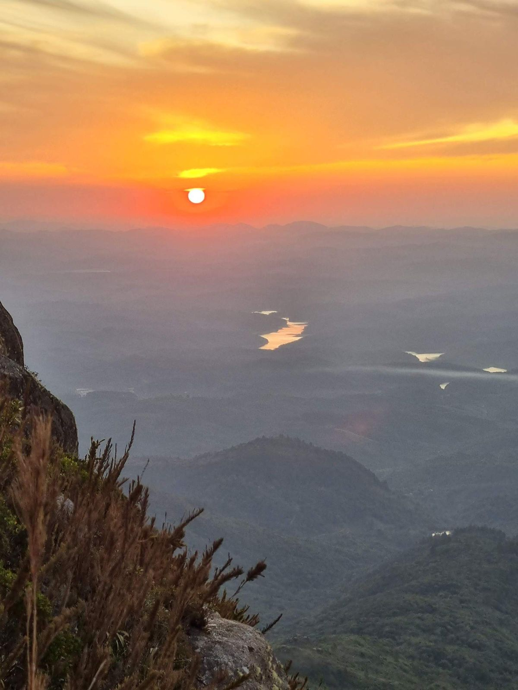

No dia seguinte acordamos mais cedo, perto das 6h, e partimos sentido a agulha Rudolf Stamm do Caratuva, local e vias que ainda não conhecíamos, vimos o nascer do sol durante a aproximação, o visual estava incrível! Para acessar o cume dessa agulha tem que se escalar a via “Vai que é fácil” (8c? A0 17m) que ainda não foi encadenada, essa fizemos em artificial mesmo para ganhar tempo, chegando no cume da agulha 7h07, dali começamos o rapel que leva até a base da agulha para poder escalar a via “A parada é dura” 7a (7c A0) D2 E2 82m.

Essa via me surpreendeu e muito, escalada bonita e com muito visual para o Taipabuçu e o grande vale até ele, escalamos toda em livre e com vista para as primeiras horas do sol e mar de nuvens, agradeço aos conquistadores Márcio Merkl e Maria Inez que nos forneceram o croqui e dicas de acesso antes mesmo da divulgação para que a gente conseguisse acessar a agulha e fazer a primeira repetição das vias durante a travessia.

Saímos da agulha era perto das 10h20, fomos até o cume do Caratuva desarmar o acampamento e seguir nosso trajeto, descemos a trilha principal do Caratuva com sol na cabeça, e foi um alívio quando pegamos a trilha sentido Pico Paraná novamente, um pouco de sombra e frescor em meio ao calor que fazia, chegando na bica fizemos uma boa pausa para comer, fiz meu último resto de comida liofilizada que tinha restado e comemos ali mesmo, pois o dia seria longo e essa seria a última refeição decente.

Partimos sentido Itapiroca, onde fizemos a via Clandestina (7b A0 26m), Murilo guiou, fui rebocando as mochilas logo depois, mais um vara mato nas caratuvas e chegamos no cume do Itapiroca, onde paramos para descansar por alguns minutos conversando com um grupo que acampava ali. Seguimos sentido Tucum, a trilha agora era mais longa e estava cada vez mais cansativa, com tudo acumulado.

Com muito sacrifício chegamos aos pés do Tucum, já de noite, exaustos, subir aquela trilha íngreme foi muito difícil, a mochila parecia pesar o dobro do que pesava no primeiro dia, mas finalmente chegamos na bifurcação que levava ao setor de escalada, só mais uma via, só mais uma via, com o cansaço acumulado, corpo e mente exaustos, até encontrar a base da via Arestona foi uma dificuldade.

Começamos a escalar a Arestona (4º VIsup E3 288m) era 19h45, achando que estava praticamente finalizada a aventura, mero engano, por ser uma via mais exposta principalmente nas partes mais fáceis, com lanternas já fracas e também o cansaço acumulado, o desafio do momento foi encontrar as proteções durante a noite, sem querer acabamos pulando algumas proteções que não vimos, trechos que eram pra ter 10m entre cada proteção se tornaram 20m, 30m e até 40m, quando o Murilo acabou pegando uma linha inexistente e paralela por engano e foi tocando até a parada.

Finalizamos a Arestona às 21h37, exaustos, felizes por ter corrido tudo bem, com muito esforço e aventura, em êxtase. Dali pra frente era só fazer a trilha até a fazenda, do cume do Camapuã acionamos nosso resgate (tio do Murilo), que nos encontrou na fazenda Bolinha onde chegamos perto de meia-noite, assim finalizando o último dia e que parecia infinito com cerca de 18h de atividade, totalizando toda a travessia com aproximadamente 1.544m de escalada e 38,6km de trilhas em 4 dias, do dia 21 a 24 de Julho de 2022.

Valeu Murilo pela parceria foda e topar essas loucuras, foram dias muito bem vividos. Que venham as próximas.

SURUCUCUUUUUUU! 🤩🤘🏻

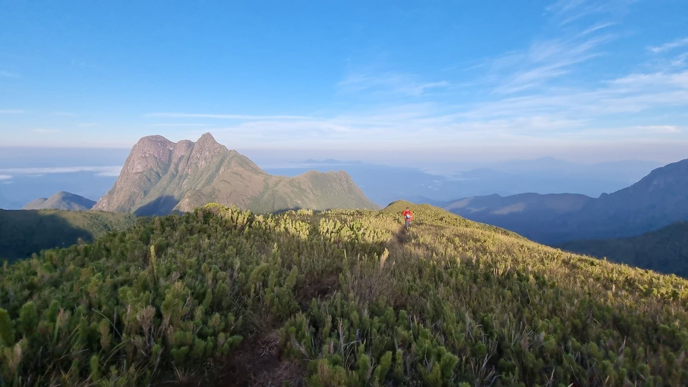 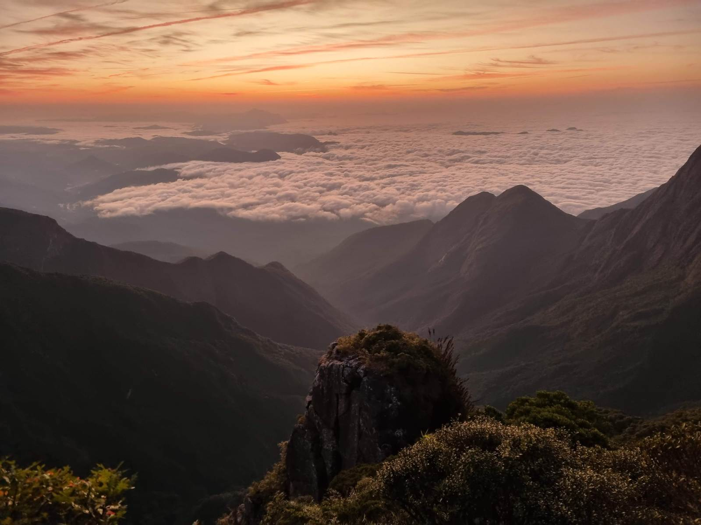 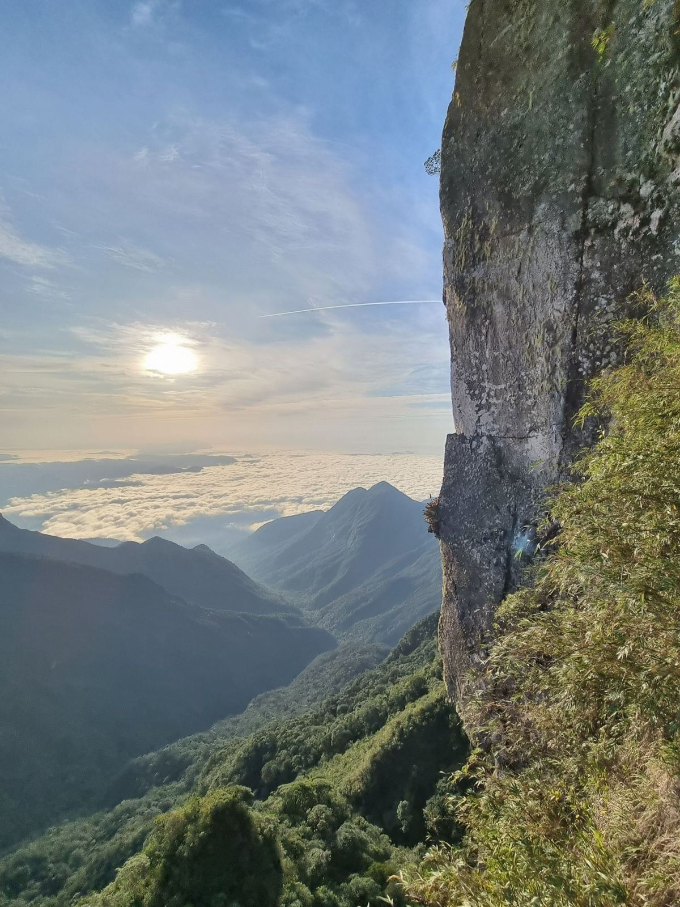 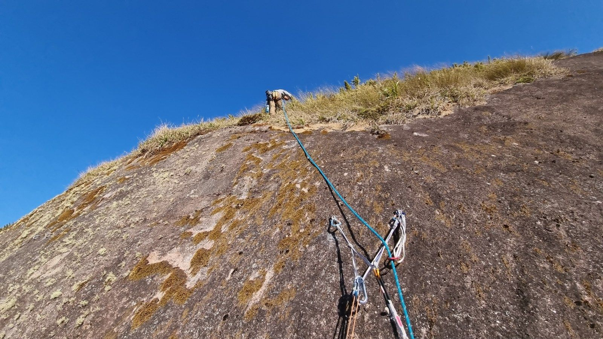 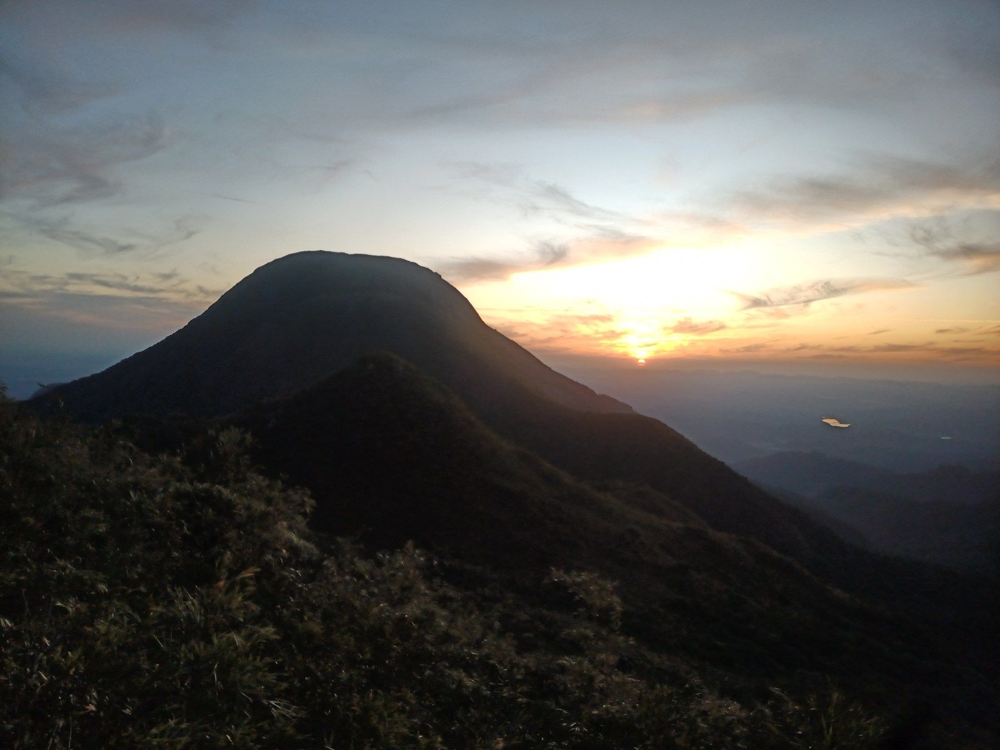 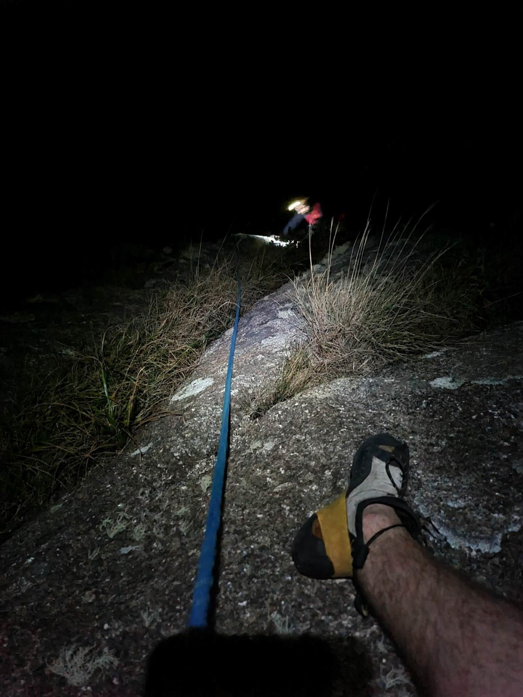

## Lista de vias

Aqui se vive 6º VIIIb A1 E2 D4 510m

Mar de Caratuvas   5° VI E4 D4/D5 621m

Vai que é fácil 8c A0 17m

A parada é dura 7a (7c A0) D2 E2 82m

Clandestina 7b A0 26mArestona 4o VIsup E3 288m

Arestona 4º VIsup E3 288m

## Trajeto

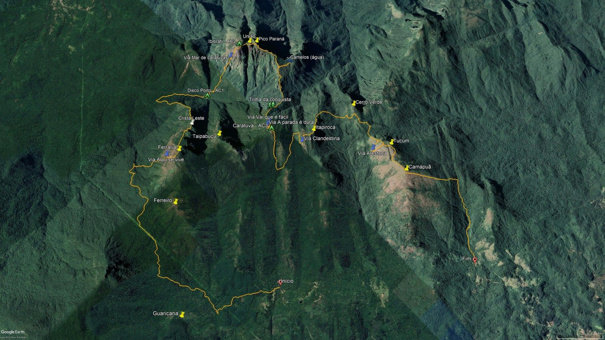

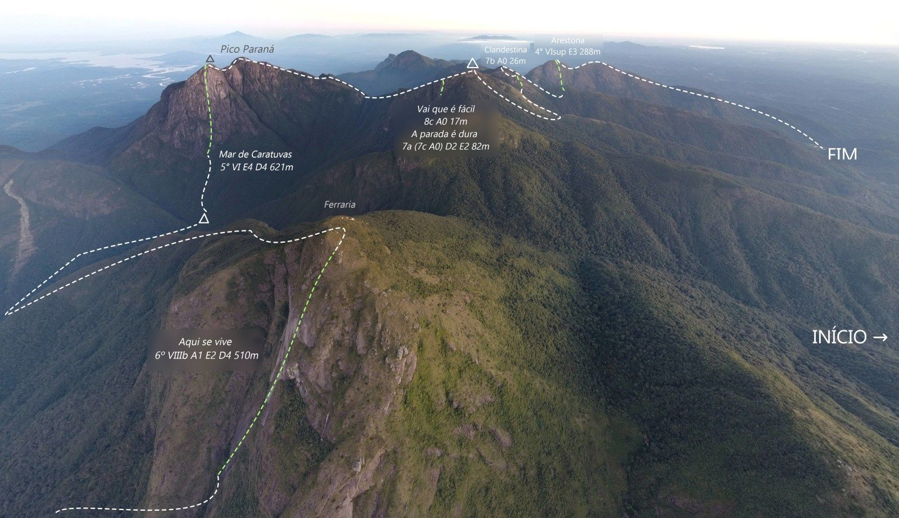

> **Relato da Travessia Rock’n Roll**
>
> Tarde! Este finde fizemos uma nova travessia na serra. Iniciamos na quinta-feira de madrugada e terminamos sábado final da tarde, perfazendo 30 km de trilhas e 1400 metros de escalada. Partimos da Fazenda Rio das Pedras e fizemos a trilha até a base de via Aqui Se Vive, 500m, no Ferraria, a qual escalamos em 5,5 horas, em seguida descendo a trilha Crista Leste, que por sinal estava fechada de bambus e galhos secos, parecendo que havia passado um tornado lá. Chegamos destruídos no Disco Porto, duvidando da nossa capacidade até, mas depois de 2 miojos e remédios pra coluna e pra gripe me senti bem melhor. No outro dia levantamos tarde e pegamos um bom sol na via Mar de Caratuvas, no Ibitirati, terminando-a 17h, já quase sem água. Seguimos o rolê, União, Pico do Paraná, e pensamos de dormir no Abrigo 2, mas certamente estávamos lesados essa hora e passamos direto. Chegamos tipo zumbi no rio depois do Abrigo 1. Ali tem um lugarzinho incrível para colocar uma barraca. Mais 2 miojos e desmaiamos. No terceiro dia partimos para escalar a via 10 Anos, no Itapiroca, essa era curtinha, apenas 25 metros, mas muito bacana e o visual estava incrível 🤩. Depois seguimos pela trilha que ligaria o cume do Itapiroca até a base da via Arestona, 288m, no Tucum. No fundo do vale, entre as duas montanhas, cozinhamos o último miojo. Dali até a base foram mais uns 50 minutos e depois mais duas horas para completar o trecho de escalada. Agora era só “zumbizar” até a Fazenda da Bolinha, na qual chegamos com as últimas luzes. Foi uma aventura incrível, a qual realizei com meu parceiro Val (Valdesir Machado). Ahhh, a gripe, as dores na coluna e a labirintite já não nos incomodam mais. Montanha cura tudo!!!!!
>
> **(Por Ed Padilha e Valdesir Machado)**
